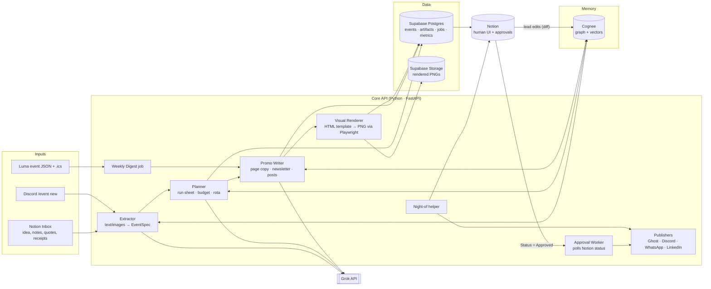

# Event Autopilot: Architecture & Decision Log

> Track 3: Run Sheet, Promo & Newsletter
> Team: 2 people · License: MIT · Memory: Cognee · LLM: Grok

**One-liner:** A lead types one line ("AI x Climate meetup, 14 Nov, ~60 people, pizza"). The system builds a run sheet, budget, volunteer rota, on-brand visuals, a Ghost newsletter draft, and WhatsApp, LinkedIn and Discord posts. Everything lands in Notion as an approval card, and the lead clicks **Approve**. Cognee remembers the community's voice, venues, suppliers, volunteers and every edit the lead makes, so each week needs less editing.

---

## 1. What we demo (work backwards from this)

1. Type a one-line idea into Notion (or `/event new` in Discord).
2. About 60 seconds later Notion shows:
   - an Event page with run sheet, budget and volunteer rota
   - 4 visuals: square post, LinkedIn banner, Luma cover, story
   - a newsletter draft that already exists in Ghost
   - WhatsApp, LinkedIn and Discord posts
3. The lead edits one post ("less hype"), then clicks Approve. It gets published, and Cognee stores the preference.
4. A second event is generated. The copy now follows the preference without being told. **This shows the memory working.**
5. Weekly digest: one button pulls this week's Luma events and drafts the newsletter and group message.
6. Night-of: `/late food 20` in Discord shifts the run sheet and posts the update to the group.
7. A **hours-saved counter** sits on screen the whole time.

If something isn't on this list, it's a stretch goal.

---

## 2. System architecture



### Who does what

| Component | Job | Source of truth |
|---|---|---|
| **Notion** | The only UI the lead uses: inbox, event pages, approval cards, run sheet, rota | Human-facing state |
| **Supabase** | Event data, artifacts, job queue, metrics, PNG storage (Notion needs public image URLs) | System state |
| **Cognee** | Long-term memory: brand voice, past events, venues, suppliers, volunteers, lead preferences | Knowledge |
| **Grok** | Extraction, planning, copy (JSON-mode, structured output) | n/a |
| **Playwright** | Renders HTML/CSS templates to PNGs. Visuals come from code, not image models | n/a |
| **Ghost** | Newsletter: create draft, then publish + send on approve | n/a |
| **Discord** | Night-of helper bot + posting via webhook | n/a |

### Core data object: `EventSpec`

Every module reads and writes this Pydantic model, so it's the contract between the two of us.

```python
class EventSpec(BaseModel):
    id: str
    title: str
    one_liner: str
    date: datetime
    start: time; end: time
    venue: Venue | None            # name, address, capacity, contact
    expected_attendees: int
    audience: str
    format: Literal["meetup","workshop","hackathon","social","talk"]
    speakers: list[Person]
    food: list[LineItem]
    budget: list[LineItem]          # from quotes/receipts, source = file ref
    run_sheet: list[Slot]           # time, duration, item, owner
    rota: list[Shift]               # role, volunteer, start, end
    luma_url: str | None
    brand: BrandTokens              # colors, fonts, logo URL, voice notes
    missing: list[str]              # what the extractor couldn't find → asks lead
```

---

## 3. Pipelines

### 3.1 Intake → Plan
1. New row appears in Notion `Inbox` DB (title = one-liner, files = quotes/receipts).
2. `extractor`: text, plus receipts/quotes images through the Grok vision model → partial `EventSpec`.
3. `cognee.search("venues/suppliers/volunteers/brand voice similar to <event>")` fills the gaps (e.g. "last time 60 people ate 15 pizzas from X; Y venue has a projector").
4. `planner` → run sheet (template per `format` + LLM tweaks), budget (line items + per-head), rota (match volunteer pool and availability from memory, max 2 shifts each).
5. Write to Supabase, then sync to the Notion Event page + child DBs.
6. Anything still missing goes into a "❓ Needs you" callout at the top of the Event page.

### 3.2 Promo
For each artifact type, generate the content, store it as an `artifact` row with status `pending`, and create a Notion **Approval card**:

| Artifact | Generator | Publish target |
|---|---|---|
| Event page copy | Grok | Shown in Notion. Lead copies to Luma (Luma write API needs Plus) |
| Newsletter | Grok → HTML/Lexical | Ghost Admin API `posts` (draft → publish + `newsletter`) |
| Discord post | Grok | Discord webhook |
| WhatsApp group msg | Grok | whatsapp-web.js sidecar (spare number), fallback `wa.me` share link |
| LinkedIn post | Grok | Share-on-LinkedIn as the lead (OAuth), fallback copy + "open composer" link |
| Visuals ×4 | Template + `EventSpec` → Playwright PNG | Supabase Storage, attached to the posts |

### 3.3 Approval loop (the "one click")
- Notion `Approvals` DB: `Artifact`, `Event`, `Channel`, `Preview` (text + image), `Status` (Draft / Approved / Rejected / Published), `Lead notes`.
- Worker polls Notion every 15s (no public webhook URL needed) → on `Approved`: publish, set `Published`, store the live URL.
- **Learning:** before publishing, diff the lead's edited text against the generated text. If they differ, call `cognee.add("Lead edit on <channel>: before/after/notes")` then `cognify()`. Rejections with notes are stored the same way.

### 3.4 Weekly digest
- Cron (Mon 09:00) or a Notion button → read the Luma calendar `.ics` → `api.lu.ma/event/get` for each event in the next 7 days.
- Grok writes the newsletter and group message in the community voice (from Cognee) → Approval cards, same as 3.3.

### 3.5 Night-of helper (Discord bot)
- `/checkin <name>`: marks the guest in Supabase (guest list from Luma CSV export or Zero sync). Also a mobile check-in page with search.
- `/now`, `/next`: current and next run-sheet slot.
- `/late <slot> <mins>`: shifts every later slot, updates Notion, posts "⏱ Food now 19:20" to the group.
- `/change <free text>`: Grok parses it into a run-sheet edit, asks for confirmation, then pushes it.

---

## 4. Cognee: what goes into memory

| Dataset | Contents | Seeded from |
|---|---|---|
| `brand_voice` | Past newsletters, LinkedIn posts, Luma descriptions | AI Pilled data, Luma history, Substack RSS |
| `past_events` | Past events with attendance, what worked | Luma JSON, Outpost CSVs |
| `suppliers_venues` | Venues, caterers, prices, contacts, quirks | Quotes/receipts the lead uploads |
| `volunteers` | Names, roles, skills, availability, hours done | Made up for the demo |
| `lead_prefs` | Every edit/rejection diff + notes | Approval loop (grows automatically) |

Usage pattern:
```python
await cognee.add(text_or_file, dataset_name="brand_voice")
await cognee.cognify(datasets=["brand_voice"])
ctx = await cognee.search(query_text="How does this community announce workshops?",
                          query_type=SearchType.GRAPH_COMPLETION)
```
Retrieved context goes into every Grok prompt under `## Community memory`.

---

## 5. Hours-saved metric

Each artifact type gets a manual baseline (minutes). Get these from leads on the night if you can, otherwise use these:

| Task | Manual (min) | Ours (min, lead review) |
|---|---|---|
| Run sheet | 45 | 3 |
| Budget sheet | 30 | 2 |
| Volunteer rota + chasing | 60 | 3 |
| Event page copy | 30 | 2 |
| Visuals ×4 | 120 | 1 |
| Newsletter | 60 | 4 |
| 3 channel posts | 30 | 2 |
| Night-of updates | 30 | 2 |
| **Total / event** | **~6.75 h** | **~0.3 h** |

`metrics` table logs `baseline_min` and `actual_review_seconds` (approval time minus creation time, capped) per artifact. The dashboard (a Notion number or a small page) shows **"Volunteer hours saved this week"**.

---

## 6. Supabase schema (minimal)

```sql
events      (id, notion_page_id, spec jsonb, status, created_at)
artifacts   (id, event_id, kind, channel, content jsonb, image_urls text[],
             status, notion_page_id, published_url, created_at, approved_at)
guests      (id, event_id, name, email, checked_in_at)
metrics     (id, artifact_id, baseline_min, review_seconds)
jobs        (id, kind, payload jsonb, status, error, run_at)   -- simple queue
```

---

## 7. Repo layout

```
event-autopilot/
├── api/                    # Python, FastAPI (Person A)
│   ├── main.py             # routes: /intake, /digest, /approve-poll, /health
│   ├── models.py           # EventSpec + friends (shared contract)
│   ├── llm.py              # Grok client (OpenAI-compatible SDK), JSON-mode helpers
│   ├── memory.py           # Cognee wrapper: remember(), recall(), learn_from_edit()
│   ├── extract.py  plan.py  promo.py  digest.py
│   ├── notion_sync.py      # Supabase ⇄ Notion
│   ├── publishers/         # ghost.py discord.py linkedin.py whatsapp.py
│   └── worker.py           # approval poller + cron
├── render/                 # Person B
│   ├── templates/          # square.html banner.html luma.html story.html (+ brand.css)
│   └── render.py           # Playwright: template + spec → PNG → Supabase Storage
├── bot/                    # Discord night-of helper (discord.py)
├── wa-sidecar/             # optional Node whatsapp-web.js, POST /send
├── seed/                   # Luma scrape scripts, fake budgets/rotas, cognee seeding
├── docs/ARCHITECTURE.md
└── LICENSE (MIT)
```

---

## 8. Team split

| Person A: Brain (backend + AI) | Person B: Face (visuals + UX + demo) |
|---|---|
| FastAPI skeleton, `EventSpec` | Notion workspace template (Inbox, Events, Approvals, Rota) |
| Grok prompts: extract / plan / promo | 4 HTML visual templates + brand tokens |
| Cognee wrapper + seeding | Playwright renderer + Supabase Storage |
| Notion sync + approval worker | Discord bot (night-of) + check-in page |
| Ghost + Discord publishers | Hours-saved dashboard |
| Weekly digest | Seed data (Luma scrape, fake budgets/rotas), demo script, README, video |

**Agree on the `EventSpec` JSON in the first 30 minutes.** After that you can both work in parallel against a fixture file `seed/sample_event.json`.

---

## 9. Build timeline (assumes ~24h; compress proportionally)

| Hours | Person A | Person B |
|---|---|---|
| 0–1 | Decisions below, repo, keys, `EventSpec` | Same, plus Notion workspace |
| 1–5 | Extract → plan → Supabase → Notion (happy path) | Templates + renderer working on fixture |
| 5–9 | Promo copy + Ghost draft + approval worker | Seed Cognee data, Discord bot skeleton |
| 9–13 | Cognee recall in prompts + learn-from-edit | Visuals attached to approval cards, check-in |
| 13–16 | Weekly digest from Luma | Hours-saved dashboard |
| 16–20 | **Integration + end-to-end runs ×5** | Night-of commands, polish visuals |
| 20–24 | Bug fixes, fallbacks | Demo script, recorded backup video, README |

**Feature freeze at hour 18.** After that, only fixes.

---

## 10. Risks & fallbacks

| Risk | Fallback |
|---|---|
| Grok output breaks JSON | Pydantic validate + 1 retry with error message, then template default |
| Cognee slow on `cognify` | Pre-cognify seed data before demo. Run learn-from-edit cognify in the background |
| Notion API rate limit (~3 req/s) | Batch block appends, sync only diffs |
| WhatsApp unofficial lib bans/QR issues | `wa.me/?text=` share link + copy button |
| LinkedIn OAuth not approved in time | Copy + "Open LinkedIn" link (still counts as one click) |
| Luma API (Plus) unavailable | Public `event/get` JSON + `.ics` (tested, no key) |
| Live demo network dies | Pre-recorded video + pre-generated event already in Notion |

---

## 11. Decision log

Each one has a recommendation. Tick it, or cross it out and write your choice. **Bold = recommended.**

### Product
- [ ] **D1 Primary lead UI:** **Notion only** / custom Next.js dashboard / Discord-first
  *Why Notion:* the brief asks for it, leads already live there, and it's zero frontend work.
- [ ] **D2 Intake surface:** **Notion Inbox DB** (+ Discord `/event new` stretch) / web form / WhatsApp message
- [ ] **D3 Approval granularity:** **one card per artifact** / one card per event (approve all)
  *Tip:* per-artifact for the demo, plus an "Approve all" button.
- [ ] **D4 Which channels publish for real in the demo:** **Ghost + Discord real, WhatsApp/LinkedIn via share link** / all real
- [ ] **D5 Night-of helper surface:** **Discord bot** / WhatsApp bot / web page
- [ ] **D6 Demo community/brand:** **one real community from the data offered (AI Pilled / Outpost)** / made-up brand
  *Why real:* judges ask "would a lead trust it?", and real voice data answers that.

### Tech
- [ ] **D7 Backend language:** **Python (FastAPI)** / Node (Next.js API routes)
  *Why Python:* Cognee is Python-native. Use a tiny Node sidecar only if you go real-WhatsApp.
- [ ] **D8 Grok model choice:** **one strong model for planning/newsletter + a fast cheap one for posts/parsing**. Check names in the xAI console, set via `GROK_MODEL_SMART` / `GROK_MODEL_FAST`.
- [ ] **D9 Structured output method:** **JSON schema / response_format + Pydantic validation** / function calling
- [ ] **D10 Visual rendering:** **HTML/CSS templates + Playwright (Python)** / Puppeteer (Node) / fabric.js canvas
  *Why:* same language as backend, and CSS is fastest to make look good.
- [ ] **D11 Visual sizes:** **1080×1080, 1200×627 (LinkedIn), 1600×800 (Luma cover), 1080×1920 (story)**
- [ ] **D12 Image hosting:** **Supabase Storage public bucket** / Cloudinary / Notion uploads
- [ ] **D13 Approval trigger:** **poll Notion every 15s** / Notion webhooks (needs public URL + verification)
- [ ] **D14 Job execution:** **in-process asyncio background tasks + `jobs` table** / Celery+Redis (overkill)
- [ ] **D15 Hosting for demo:** **run locally + ngrok if needed** / Railway / Fly.io
  *Note:* repo must be public. Deploy only if time allows.

### Memory (Cognee)
- [ ] **D16 Cognee LLM provider:** **Grok via OpenAI-compatible endpoint** / OpenAI. *Check that Cognee's structured extraction works with Grok in the first hour. If not, switch.*
- [ ] **D17 Embeddings:** **local fastembed / sentence-transformers** (no key, no cost) / OpenAI embeddings
- [ ] **D18 Cognee storage backend:** **defaults (local SQLite + LanceDB + Kuzu)** / Postgres+pgvector on Supabase
- [ ] **D19 Datasets:** **5 datasets as in §4** / one big dataset
- [ ] **D20 Search type for prompts:** **GRAPH_COMPLETION for facts, CHUNKS for voice examples** / single type
- [ ] **D21 Learn-from-edits:** **store diff + notes on every approval/rejection** / only on rejection

### Data
- [ ] **D22 Event source for weekly digest:** **Luma .ics + event/get JSON (no key)** / Luma API (Plus) / Zero
- [ ] **D23 Guest list for check-in:** **Luma CSV export / seeded fake guests** / Zero Luma sync
- [ ] **D24 Budgets/rotas:** **made-up but realistic seed data** (the brief allows it)

### Metrics & judging
- [ ] **D25 Hours-saved baselines:** **table in §5, validated by asking 1–2 leads on the night**
- [ ] **D26 What we measure live:** **review time per artifact (created → approved)** / just baselines
- [ ] **D27 License:** **MIT** / Apache-2.0 / AGPL-3.0 (needed if we fork listmonk/Postiz)
- [ ] **D28 Fork a starter or build from scratch:** **build from scratch, use Ghost SDK only** / fork Postiz for scheduling

### Process
- [ ] **D29 Ownership split:** **§8 table** / other
- [ ] **D30 Feature freeze time:** **hour 18**
- [ ] **D31 Backup demo:** **recorded video + pre-generated event**

---

## 12. Env vars

```
GROK_API_KEY=            GROK_BASE_URL=https://api.x.ai/v1
GROK_MODEL_SMART=        GROK_MODEL_FAST=
NOTION_TOKEN=            NOTION_INBOX_DB=  NOTION_EVENTS_DB=  NOTION_APPROVALS_DB=
SUPABASE_URL=            SUPABASE_SERVICE_KEY=   SUPABASE_BUCKET=visuals
GHOST_ADMIN_URL=         GHOST_ADMIN_KEY=        GHOST_NEWSLETTER_SLUG=
DISCORD_BOT_TOKEN=       DISCORD_WEBHOOK_URL=
LUMA_CALENDAR_ID=
LLM_PROVIDER / LLM_ENDPOINT / LLM_API_KEY / EMBEDDING_PROVIDER   # Cognee
```

---

## 13. Pitch (30 seconds)

> "Every week a volunteer spends ~7 hours writing the event page, making graphics, writing the newsletter and posting everywhere. Event Autopilot turns one line into all of it and puts it in Notion for one-click approval. Visuals come from code templates, so they're always on-brand. Cognee remembers the community's voice and every edit the lead makes, so it gets better every week. That's 6+ volunteer hours back per event."
