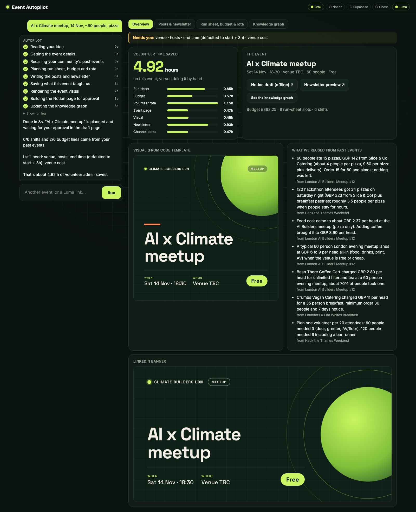
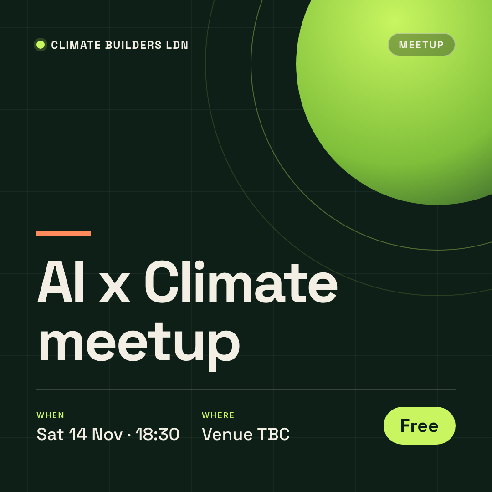
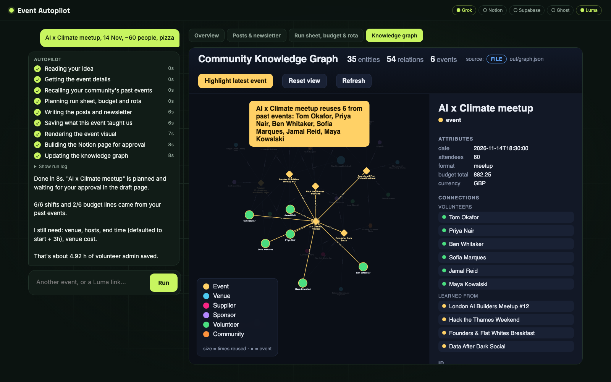

# Event Autopilot

**One line in. The whole event out.**

Type an event idea or paste a Luma link. In about a minute Event Autopilot plans the run sheet, budget and volunteer rota from your community's past events. It also writes the posts and newsletter with Grok, renders an on-brand visual from a code template, and builds a Notion workspace where the lead approves everything.

Built for Track 3 (Run Sheet, Promo & Newsletter) of the Grok × SpaceX hackathon. MIT licensed.



## What it does

1. **Understands the event:** a one-line idea or any public Luma link (title, date, venue, hosts, guest count).
2. **Recalls what the community already knows:** venues, suppliers, sponsors, volunteers and lessons from past events, stored in a shared knowledge base in Supabase.
3. **Plans it:** run sheet, budget and volunteer rota. Every budget line says where its number came from, either "memory: <past event>" or "default estimate".
4. **Writes the promo with Grok:** event page copy, newsletter, LinkedIn post and WhatsApp group message. Organiser-only notes (costs per head, quantities, volunteer counts) are kept out of public copy, and the only link allowed is the real Luma link.
5. **Renders visuals from HTML templates, not an image model:** a 1080×1080 post and a 1200×627 LinkedIn banner, restyled from one `brand.css`.
6. **Builds the Notion workspace** for approval (below).
7. **Learns:** what this event used is written back, so the next organiser starts further ahead. The knowledge graph shows the new event latching onto past venues, suppliers and volunteers.
8. **Counts the volunteer hours saved** per task against manual baselines.

| Visual (from code) | Knowledge graph |
|---|---|
|  |  |

## The Notion workspace

Five sections. **Money is the hub**: every other table has a two-way relation to the Money ledger.

| Section | Tables | Links to Money |
|---|---|---|
| 💷 **Money** | Money ledger: estimated / committed / paid, source, where each number came from. Summary of projected spend and sponsor prospects | n/a |
| 🤝 **Sponsorship** | Sponsors: past sponsors become prospects with their last amount | Expected income line |
| 🙋 **Volunteers** | Volunteer shifts from the rota | Only if expenses are claimed |
| 🏛️ **Venues** | Spots · Food suppliers | Venue hire and food lines |
| 📣 **Posts** | Newsletter · Posters · Event page · Social posts (Discord, LinkedIn, WhatsApp group) | Printing / paid promotion |

Each event also gets a page with "Needs you" (missing info), "At a glance", hours saved, run sheet, budget, rota and the community memory used. Every post starts as **Draft**. Running the same event again replaces its rows instead of duplicating them, and several machines can push to one workspace.

## Quick start

```bash
git clone https://github.com/9ren4/Grok-X-SpaceX.git && cd Grok-X-SpaceX
python3 -m venv .venv && .venv/bin/pip install -r requirements.txt
.venv/bin/python -m playwright install chromium
cp .env.example .env          # add the keys you have (see below)

.venv/bin/python -m eventautopilot.app      # chat front page → http://localhost:8000
```

Or from the terminal:

```bash
.venv/bin/python -m eventautopilot.pipeline "AI x Climate meetup, 14 Nov, ~60 people, pizza"
.venv/bin/python -m eventautopilot.pipeline https://lu.ma/<event>
```

Graph page on its own: `python3 -m http.server` from the repo root, then open `/graph/index.html`.

### Keys

Every key is optional. A missing one falls back instead of crashing, and the chat page header shows what's connected.

| Key | Turns on | Without it |
|---|---|---|
| `GROK_API_KEY` (+ `GROK_MODEL_SMART`, `GROK_MODEL_FAST`) | Grok-written copy | Deterministic templates |
| `NOTION_TOKEN`, `NOTION_PARENT_PAGE_ID` | Live Notion workspace | Markdown page in `out/` |
| `SUPABASE_URL`, `SUPABASE_SERVICE_KEY` | Shared knowledge base, public image hosting for Notion | Local `out/memory.json`, images stay local |
| `SUPABASE_ANON_KEY` | Graph page reads Supabase directly | Graph reads `out/graph.json` |
| `GHOST_ADMIN_URL`, `GHOST_ADMIN_KEY` | Newsletter created as a Ghost **draft** (never sent) | HTML preview in `out/` |

Notion: create an internal integration, share an empty page with it, and use that page's ID as `NOTION_PARENT_PAGE_ID`. The sections and tables are created on the first run.

### Supabase

```bash
# in the Supabase SQL editor, run supabase/schema.sql, then seed/knowledge.sql
.venv/bin/python seed/load_demo.py          # five more past events; safe to re-run
```

## What's real and what's seeded

- **Past events in the knowledge base are fictional demo data.** Every seeded entity carries `attrs.seed = true`, and the graph labels them "seeded example". The event you run is live.
- **Budgets and rotas for past events are made up**, as the track brief allows.
- **Approving a post marks it approved.** It does not send anything yet.
- **The Discord post reuses the WhatsApp copy.** Grok doesn't write a separate Discord version yet.
- **A full run takes about 60 seconds**, mostly writing Notion rows one at a time. The chat page shows each step live.

## Not built yet

Publishing on approve (Discord bot, Share on LinkedIn, WhatsApp group), the weekly Luma digest, the night-of helper (check-in, timings, last-minute changes), and reading notes, quotes and receipts dropped into Notion.

## Project layout

```
eventautopilot/
  app.py          chat front page (FastAPI) + streaming run
  pipeline.py     orchestration: input → recall → plan → copy → learn → visual → publish → graph
  luma.py         public Luma event fetch
  memory.py       knowledge base (Supabase, local JSON fallback)
  planner.py      run sheet, budget, rota
  copy.py         Grok copy with templates as fallback
  visuals.py      HTML template → PNG (Playwright), upload to Supabase Storage
  face.py         visual → Ghost draft → Notion, each step degrades alone
  notion_sync.py  event page + hours-saved dashboard
  workspace.py    the five Notion sections, Money as the hub
  ghost.py        Ghost Admin API draft
web/index.html    chat UI
graph/            knowledge graph page (Cytoscape)
visuals/templates square.html, banner.html, brand.css
supabase/         schema
seed/             knowledge base seed + demo loader
docs/             architecture and design notes
```

## Team

Aryan (Notion, visuals, Ghost, graph, chat page) and Mehedi (Luma, knowledge base, planner, copy, pipeline).

## License

MIT, see [LICENSE](LICENSE).
