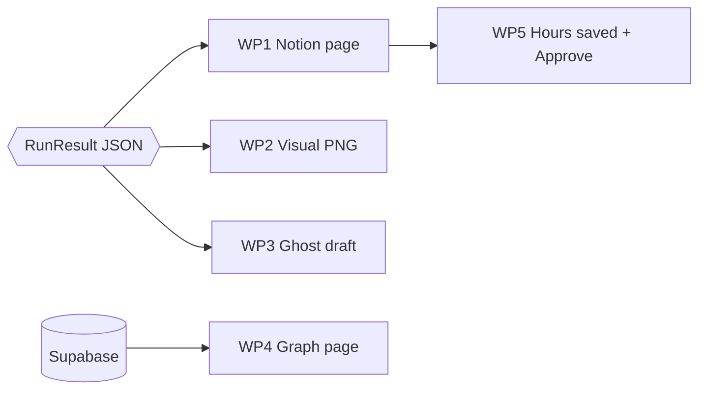

<div align="center">

# 🎨 Aryan — The Face

### Everything a judge actually sees.

You take a finished `RunResult` and turn it into a **Notion workspace**, a **visual**, a **Ghost newsletter draft**, and a **live knowledge graph**.

`Code freeze 21:50` &nbsp;·&nbsp; `Branch: aryan/*` &nbsp;·&nbsp; back to [PROJECT.md](./PROJECT.md)

</div>

---

## 🎯 Your one-line mission

> Take one `RunResult` JSON and make it look like a product: a Notion event page the lead can approve, a branded image, a newsletter draft waiting in Ghost, and a graph that shows the shared memory growing.



You do **not** need to wait for Mehedi. Build against `seed/sample_run.json` (his Step 0 delivers it, usually within ~10 minutes). Until then, hand-write a rough one from the fields below.

---

## 📦 Files you own

```
eventautopilot/
├── notion_sync.py     WP1 + WP5
├── ghost.py           WP3
└── visuals.py         WP2
visuals/
├── templates/
│   ├── square.html    1080×1080
│   └── brand.css
└── render.py
graph/
└── index.html         WP4  (static page, Cytoscape from CDN)
```

**Don't touch:** `models.py`, `luma.py`, `memory.py`, `planner.py`, `copy.py`, `pipeline.py`. Those are Mehedi's. Need a field changed? Ask him.

---

## 📥 What you receive: `RunResult`

```jsonc
{
  "spec": {
    "title": "AI x Climate Meetup",
    "date": "2026-11-14T18:30:00",
    "start": "18:30", "end": "21:30",
    "venue": { "name": "...", "city": "London", "capacity": 80 },
    "expected_attendees": 60,
    "hosts": [{ "name": "..." }],
    "ticket_price": 0.0,
    "luma_url": "https://lu.ma/...",
    "cover_url": "https://images.lumacdn.com/...",
    "run_sheet": [{ "time": "18:30", "duration_min": 30, "item": "Doors", "owner": "Check-in" }],
    "budget":    [{ "label": "Pizza", "qty": 15, "unit_cost": 9.5, "note": "...",
                    "source": "memory: AI x Climate, Shoreditch" }],
    "rota":      [{ "role": "Check-in", "volunteer": "Sam", "start": "18:00", "end": "20:00" }],
    "missing":   ["venue address"]
  },
  "artifacts": { "page_copy": "...", "newsletter_subject": "...", "newsletter_html": "<p>…</p>",
                 "linkedin": "...", "whatsapp": "..." },
  "memories_used": [{ "kind": "budget", "text": "...", "provenance": "AI x Climate, Shoreditch" }],
  "learned": 7,
  "hours_saved": 6.4,
  "log": ["luma: fetched in 0.6s", "memory: recalled 9 facts", "…"]
}
```

Load it with `RunResult.model_validate_json(...)` from `eventautopilot.models`. Treat `missing` as "show a ❓ callout", never as an error.

---

## 🧩 Work packages

Each is sized for **one coding agent**. Hand it the package text, the files it owns and the definition of done.

---

### WP1 · `notion_sync.py` — the Notion workspace &nbsp; ⏱️ ~40 min 🟥 MUST

**Goal:** `push(result: RunResult) -> str` creates the event page in Notion and returns its URL.

**Setup (do first, ~2 min)**
1. notion.so/my-integrations → New internal integration → copy the secret → `NOTION_TOKEN`
2. Create a page called **Event Autopilot**, open `···` → *Connections* → add your integration
3. Copy its ID → `NOTION_PARENT_PAGE_ID`

**Page layout** (one page per event, created under the parent)

```
📅 {title}                                  ← page title, cover = spec.cover_url
┌ ❓ Needs you         (callout, only if spec.missing is non-empty)
├ 📊 At a glance       (callout: date · venue · attendees · budget total · £/head)
├ ⏱️ Hours saved       (callout: "6.4 h of volunteer admin saved")
│
├ ## Run sheet         → table: Time | Duration | Item | Owner
├ ## Budget            → table: Item | Qty | Unit | Total | Source        ← Source column matters
├ ## Volunteer rota    → table: Role | Volunteer | Start | End
│
├ ## 🧠 Community memory used
│     bullets: "{text}  — from {provenance}"
│
└ ## Approvals         → one row per artifact, Status property
```

**The Approvals database** (create once, reuse across events)

| Property | Type | Values |
|---|---|---|
| Name | title | "Event page copy", "Newsletter", "LinkedIn", "WhatsApp", "Visual" |
| Event | rich text | the event title |
| Status | **select** | `Draft` (default) · `Approved` · `Rejected` |
| Preview | rich text | the artifact text |
| Image | files/url | the visual, if any |

The lead flips **Status → Approved**. That click *is* the approval demo.

**Notion API notes**
- Tables are `table` blocks with `table_row` children; set `has_column_header: true`
- Rich text blocks cap at **2,000 characters**: chunk long copy
- ~3 requests/sec: **batch children in one call** (up to 100 blocks)
- Image blocks need a **public URL**. Skip images if the visual isn't hosted yet, and link it instead

**No token?** Print the page as Markdown to `out/<id>.md` and log `notion: dry-run (no token)`. Never crash.

**Definition of done**
- [ ] `push(sample_run)` creates a page with run sheet, budget (with Source column), rota, memory strip, hours-saved callout
- [ ] Approvals rows exist with `Status = Draft`
- [ ] Re-running `push` for the same event doesn't create a second page (archive or update)
- [ ] Dry-run mode works with no token

---

### WP2 · Visuals — HTML/CSS template to PNG &nbsp; ⏱️ ~30 min 🟧 SHOULD

The track says *visuals from code templates, not image models.* This is the part judges can see at a glance.

**Goal:** `render(result) -> Path` produces a 1080×1080 PNG.

**Template `square.html`** — fed by `spec`:
- Big title, date ("Fri 14 Nov · 18:30"), venue + city, "Free" or a price
- Cover image as a background layer with a dark gradient overlay (so text always passes contrast)
- Host line, small `lu.ma/…` URL at the bottom
- Brand tokens in `brand.css` (colours, font, logo slot): change one file, all visuals restyle

**Rendering: pick whichever works first**

| Option | Command | Note |
|---|---|---|
| **Playwright (Python)** ✅ | `pip install playwright && playwright install chromium` | Headless screenshot at 1080×1080. Matches the architecture |
| Headless Chrome CLI | `chrome --headless --screenshot --window-size=1080,1080 file.html` | Zero install if Chrome exists |
| Skip PNG | Open the HTML in a browser, screenshot by hand | Last resort, still shows the template idea |

> Puppeteer, fabric.js and image models are out. Don't spend time on them.

**Hosting for Notion:** Notion needs a public image URL. Quickest: upload the PNG to a **public Supabase Storage bucket** (`visuals`), or just link it. Don't block on this.

**Stretch (only if time):** `banner.html` (1200×627 LinkedIn) reusing `brand.css`.

**Definition of done**
- [ ] `render(sample_run)` writes `out/visual_<id>.png`, 1080×1080, text readable
- [ ] Long titles wrap instead of overflowing (test with 80 characters)
- [ ] Works when `cover_url` is empty (solid brand background)

---

### WP3 · `ghost.py` — the newsletter &nbsp; ⏱️ ~30 min 🟨 COULD (cut first)

**Goal:** `create_draft(result) -> str` creates a **draft** post in Ghost and returns its admin URL.

**Setup**
- Ghost(Pro) trial, or `npx ghost-cli install local` / Docker
- Admin → Settings → Integrations → *Add custom integration* → copy the **Admin API key** (`id:secret`)
- `GHOST_ADMIN_URL`, `GHOST_ADMIN_KEY`

**Auth:** Admin API uses a short-lived JWT: split the key into `id` and `secret`, sign HS256 with `bytes.fromhex(secret)`, header `kid=id`, `aud="/admin/"`, 5-minute expiry. Send `Authorization: Ghost <jwt>`. (`PyJWT` is already in `requirements.txt`.)

**Create the draft**
```
POST {GHOST_ADMIN_URL}/ghost/api/admin/posts/?source=html
{ "posts": [{ "title": <newsletter_subject>, "html": <newsletter_html>, "status": "draft" }] }
```

> **Draft only.** Do not publish or send from code. The lead sends from Ghost. That is the point of the approval flow, and it keeps us safe on stage.

**Definition of done**
- [ ] A draft appears in Ghost with the subject and rendered HTML
- [ ] Missing key → log `ghost: skipped (no key)` and return empty, no crash
- [ ] The returned URL is added to the Approvals row for "Newsletter"

---

### WP4 · `graph/index.html` — the knowledge graph &nbsp; ⏱️ ~30 min 🟨 COULD (cut last)

**Goal:** a single static page that draws the shared memory. It carries the differentiator, so make it good.

**Data source**, in order of preference:
1. **Supabase REST** with the anon key: `GET /rest/v1/entities` and `/relations` (Mehedi adds public-read policies in WP2)
2. **`out/graph.json`** written by `memory.graph()`, loaded by `fetch('./graph.json')`
3. Hard fallback: a bundled copy of the seed graph, **labelled "snapshot"**

**Page**
- Library: **Cytoscape.js** via cdnjs, pinned version
- **Colour by `kind`** (venue, supplier, sponsor, volunteer, community, event) with a legend
- **Node size by `times_used`**. Reused venues should visibly dominate. That is the thesis
- **Edge labels** from `relation` (`hosted`, `catered`, `sponsored`, `ran_shift`)
- Click a node → side panel: name, kind, `attrs`, related memories and which events
- **"Highlight latest event"** button: pulse the newest event's nodes and edges, so the before/after demo works

**Demo moment:** render → run a second event → refresh. Its nodes should latch onto the venue and caterer the *first* event used.

**Ground rule:** draw only rows that exist. If a node is seeded, its panel says **"seeded example"**.

**Definition of done**
- [ ] Opens by double-clicking `graph/index.html` (or `python -m http.server`)
- [ ] Colours, sizes and edge labels are driven by data, not hard-coded
- [ ] Highlight-latest works after a second run
- [ ] Looks good at 1080p on a projector: dark theme, readable at distance

---

### WP5 · Hours saved + polish &nbsp; ⏱️ ~20 min 🟥 MUST (it's small)

- [ ] Render `hours_saved` in the Notion callout: **"⏱️ 6.4 h of volunteer admin saved on this event"**
- [ ] Notion **dashboard** at the top of the parent page: running total across all events (sum from the Approvals/Events rows)
- [ ] Per-artifact line: *"Run sheet: 45 min manual → 3 min review"* (baselines in [PROJECT.md §9](./PROJECT.md#9--how-we-are-judged-and-how-we-score))
- [ ] Final pass: icons on headings, callout colours, consistent page cover

Small, but it is **the number the track says matters**.

---

## ⏱️ Suggested order

| Block | Do | Gate |
|---|---|---|
| 0:00–0:10 | Notion token + parent page · wait for `sample_run.json` | **C0** from Mehedi |
| 0:10–0:50 | **WP1** Notion page, end to end on the fixture | **C1** page visible |
| 0:50–1:20 | **WP2** visual · **WP4** graph (in parallel) | |
| 1:20–1:40 | **WP5** hours saved · **WP3** Ghost if time | **C2** with Mehedi |
| then | Polish, rehearse the demo, record the backup video | |

WP2 + WP4 are independent, so they can run as parallel agents. If you fall behind, **cut WP3 (Ghost) first**, never WP1 or WP4.

---

## 🔑 What you need

| Item | Needed for | Status |
|---|---|---|
| Notion integration token | WP1 | ⬜ 2 min |
| Parent page shared with it | WP1 | ⬜ |
| `playwright` + chromium | WP2 | ⬜ `playwright install chromium` |
| Ghost instance + Admin key | WP3 | ⬜ optional |
| Supabase anon key | WP4 live mode | ⬜ from Mehedi |

Every item has a fallback. Nothing blocks starting.

---

## ✅ Your acceptance checklist

- [ ] Notion page from the fixture: run sheet, budget with **Source**, rota, memory strip
- [ ] `Status` select on each approval row; flipping it works
- [ ] Hours-saved callout visible
- [ ] One PNG that you'd be happy to post
- [ ] Graph page with colours, sizes, labels, highlight-latest
- [ ] Ghost draft created (or cleanly skipped)
- [ ] Dry-run works with no keys
- [ ] Committed, pushed, merged before **21:30**
