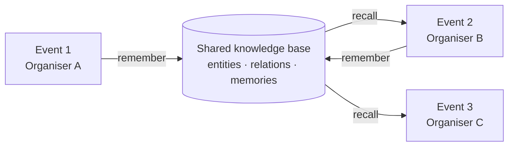
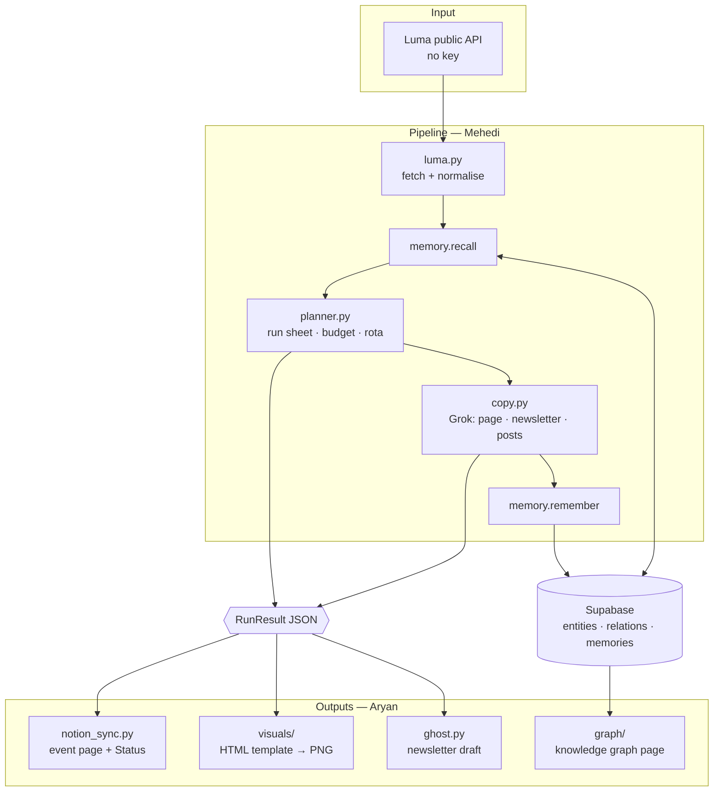

<div align="center">

# ✈️ Event Autopilot

### Paste a Luma link. Get the whole event organised.

**Run sheet · Budget · Volunteer rota · Newsletter · Posts · Visuals — in Notion, approved with one click.**

`Track 3 · Run sheet, promo & newsletter` &nbsp;·&nbsp; `Grok Bot Community Engineering Hackathon, London` &nbsp;·&nbsp; `MIT`

**Code freeze: 21:50 tonight**

</div>

---

## 📖 Contents

1. [The problem](#1--the-problem)
2. [What we are building](#2--what-we-are-building)
3. [The differentiator: a knowledge base that compounds](#3--the-differentiator-a-knowledge-base-that-compounds)
4. [The demo, beat by beat](#4--the-demo-beat-by-beat)
5. [Architecture](#5--architecture)
6. [Stack and what each piece does](#6--stack-and-what-each-piece-does)
7. [The shared contract](#7--the-shared-contract)
8. [Scope: what is in, what is cut](#8--scope-what-is-in-what-is-cut)
9. [How we are judged, and how we score](#9--how-we-are-judged-and-how-we-score)
10. [Who builds what](#10--who-builds-what)
11. [Working rules](#11--working-rules)
12. [Risks and fallbacks](#12--risks-and-fallbacks)
13. [Open questions](#13--open-questions)

> 👤 Your personal task list: [MEHEDI.md](./MEHEDI.md) · [ARYAN.md](./ARYAN.md)
> 🧠 Memory design: [KNOWLEDGE-BASE.md](./KNOWLEDGE-BASE.md) · 🗺️ Original design log: [ARCHITECTURE.md](./ARCHITECTURE.md)

---

## 1. 🔥 The problem

Every week, someone in a community writes the event page, makes the visuals, posts everywhere, sends the newsletter and chases volunteers. All by hand.

What community leads told the organisers:

| Pain | What it looks like |
|---|---|
| **Scattered info** | Venues, food, suppliers, money and volunteers live in different places |
| **Slow content** | Posts and visuals take hours; AI design tools are not good enough to ship |
| **Weekly grind** | Newsletter, group messages and social posts, every single week |
| **Burnout** | Volunteers drown in admin a machine could do. *Hours saved per volunteer is the number that matters.* |

And every new organiser **starts from zero**: nobody remembers what the last event cost, which caterer was reliable, or which venue had a projector.

---

## 2. 🎯 What we are building

**Event Autopilot** takes one Luma event link (or a one-line idea) and produces, in Notion:

| # | Output | Priority |
|---|---|---|
| 1 | **Run sheet**, **budget** and **volunteer rota** | 🟥 MVP |
| 2 | **Approval flow**: each artifact has a `Status`, the lead clicks Approve | 🟥 MVP |
| 3 | **Hours-saved** counter | 🟥 MVP |
| 4 | **Event page copy**, **LinkedIn post**, **WhatsApp message** (text only) | 🟧 Next |
| 5 | **One on-brand visual** rendered from an HTML template | 🟧 Next |
| 6 | **Newsletter** drafted and created in **Ghost** | 🟨 Then |
| 7 | **Knowledge graph page** showing the shared memory growing | 🟨 Then |
| 8 | Discord bot · real LinkedIn posting · WhatsApp groups · weekly digest | ⬜ Only if everything above is done |

---

## 3. 🧠 The differentiator: a knowledge base that compounds

> **"No organiser ever starts from zero again."**

Every event run through the platform writes what it learned into a shared knowledge base in **Supabase**. The next organiser, in any community, reads from it.



- **Entities** are the nodes: venues, suppliers, sponsors, volunteers, communities.
- **Relations** are the edges: `hosted`, `catered`, `sponsored`, `ran_shift`.
- **Memories** are the facts: *"60 people ate 15 pizzas, £142 from Pizza Pilgrims."*

When Event 2 is planned, the budget line for food says where its price came from. **That provenance is what makes a lead trust it.**

We replaced Cognee with plain Supabase tables because Cognee's install weight and slow `cognify()` sat directly in the demo path. The idea is identical and the data is easier to show. Full design: [KNOWLEDGE-BASE.md](./KNOWLEDGE-BASE.md).

---

## 4. 🎬 The demo, beat by beat

| # | Beat | What the judge sees | Proves |
|---|---|---|---|
| 1 | Paste a Luma link | Terminal / page accepts a real public event | Input works, no key |
| 2 | ~60 seconds of pipeline | Log lines: fetched → recalled N facts → planned → generated | It runs itself |
| 3 | Open Notion | Event page: run sheet, budget, rota, copy, visual | Real workspace output |
| 4 | Point at a budget line | `Food: £142 — from "AI x Climate", Shoreditch` | **Memory is real** |
| 5 | Click Approve | Status flips `Draft → Approved` | Lead stays in control |
| 6 | Run a second event | New event reuses the first one's venue and caterer | **It got smarter** |
| 7 | Open the graph | Second event's nodes latch onto the first's, highlighted | The thesis, visible |
| 8 | Hours-saved line | "6.4 h of volunteer admin saved" | The scored number |

If it is not on this list, it is a stretch goal.

---

## 5. 🏗️ Architecture



**The seam between the two halves is one JSON object, `RunResult`.** Mehedi's side produces it; Aryan's side consumes it. A fixture file lets Aryan build and test without waiting for Mehedi.

---

## 6. 🧰 Stack and what each piece does

| Piece | Role | Notes |
|---|---|---|
| **Luma public API** | Input | `api.lu.ma/url`, `event/get`, discover feed. Verified working, no key |
| **Supabase** | Knowledge base + event data | Postgres. Full-text + trigram recall, no vectors tonight |
| **Grok Bot / Grok** | Copy generation | Behind one `llm.py` switch so we can swap providers. See §13 |
| **Notion** | The workspace output | Via the official API with an integration token |
| **Ghost** | Newsletter | Admin API, create draft |
| **HTML + CSS → PNG** | Visuals | Code templates, not image models. Per the track brief |
| **Python 3.10+** | Language | Pydantic models are the contract |

**Banned tonight** (too much setup): Postiz, Puppeteer, fabric.js, Baileys, listmonk, Cognee.

Open source from day one: **MIT**, public repo `9ren4/Grok-X-SpaceX`.

---

## 7. 🤝 The shared contract

Everything hangs off these models in `eventautopilot/models.py`:

```python
EventSpec     # the event: title, date, venue, hosts, attendees, run_sheet, budget, rota
Memory        # one fact from the knowledge base (+ provenance)
Artifacts     # page_copy, newsletter_subject, newsletter_html, linkedin, whatsapp
RunResult     # spec + artifacts + memories_used + learned + hours_saved + log
```

**Rule 1:** `models.py` changes only by agreement. If you need a field, say so in the chat first.
**Rule 2:** `seed/sample_run.json` is a full example `RunResult`. Aryan builds against it from minute one.

---

## 8. ✂️ Scope: what is in, what is cut

| Tier | Item | If we run out of time |
|---|---|---|
| 🟥 Must | Luma fetch → recall → plan → Notion page with run sheet / budget / rota | Nothing else matters without this |
| 🟥 Must | `Status` approval property · hours-saved line | Cheap, scores points |
| 🟧 Should | Copy: page, LinkedIn, WhatsApp | |
| 🟧 Should | One visual from an HTML template | Judged on "copy and visuals" |
| 🟨 Could | Ghost newsletter draft | **First to cut** |
| 🟨 Could | Graph page | Cut last: it carries the differentiator |
| ⬜ Won't | Discord bot, LinkedIn posting, WhatsApp groups, digest, Zero | Mention in the roadmap slide |

---

## 9. 🏆 How we are judged, and how we score

The track says: *how much of the weekly work really runs itself, quality of copy and visuals, hours saved, and whether a lead would trust it with a real event.*

| Criterion | Our answer |
|---|---|
| Runs itself | One command, one link, ~60 seconds |
| Copy quality | Grok, grounded in recalled community facts |
| Visual quality | Template-rendered, always on-brand |
| Hours saved | Baseline table → a number on the Notion page |
| Lead trust | Every figure shows where it came from; nothing publishes without Approve |

### ⏱️ Hours-saved baselines

| Task | Manual (min) | With us (min) |
|---|---|---|
| Run sheet | 45 | 3 |
| Budget | 30 | 2 |
| Volunteer rota | 60 | 3 |
| Event page copy | 30 | 2 |
| Visual | 30 | 1 |
| Newsletter | 60 | 4 |
| Channel posts | 30 | 2 |

These are estimates from the original design. If we can ask a lead on the night for their real numbers, we swap them in and say so.

---

## 10. 👥 Who builds what

| | 🧠 **Mehedi: the brain** | 🎨 **Aryan: the face** |
|---|---|---|
| Theme | Data in, plan and copy out | Everything a judge sees |
| Owns | Luma fetch · Supabase KB · planner · Grok copy · orchestration | Notion · visuals · Ghost · graph page · hours-saved |
| Produces | `RunResult` | Notion page, PNG, Ghost draft, `graph.html` |
| Doc | [MEHEDI.md](./MEHEDI.md) | [ARYAN.md](./ARYAN.md) |

Each person's doc is split into work packages sized for one coding agent each, with files owned, inputs, outputs and a definition of done.

---

## 11. 📏 Working rules

1. **Own your files.** Each doc lists the files you own. Do not edit the other person's. Ask.
2. **Small commits, pushed often.** The other side can only integrate what is on GitHub.
3. **Branches:** work on `mehedi/*` and `aryan/*`, merge to `main` at each checkpoint.
4. **Never commit secrets.** `.env` is gitignored. Share keys privately.
5. **Everything degrades, nothing crashes.** A missing key must produce a clearly labelled fallback, not a stack trace.
6. **Never fake it.** If a thing is a fallback or seeded, the UI says so. A judge clicking into a lie costs more than a gap.

### Checkpoints

| When | Checkpoint | Both |
|---|---|---|
| **C0** | Contract pushed: `models.py`, `seed/sample_run.json` | Aryan unblocked |
| **C1** | Mehedi: real `RunResult` from a live Luma link · Aryan: Notion page from the fixture | Plug together |
| **C2** | Full run end to end, link → Notion | Record a backup video now |
| **C3** | Extras landed or cut | |
| **21:30** | Feature freeze: only fixes | |
| **21:50** | **Code freeze** | |

---

## 12. 🛟 Risks and fallbacks

| Risk | Fallback |
|---|---|
| Grok Bot has no callable API | `llm.py` falls back to xAI's Grok API, then to deterministic templates |
| Grok returns broken JSON | Pydantic validation, one retry, then template default |
| No Notion token on stage | Notion MCP for the demo; API code stays in the repo |
| Luma rate limit or a flaky link | Cache fetched events in `out/` and `seed/` |
| Supabase unreachable | JSON fallback store; the UI labels it "local memory" |
| Network dies at demo time | Pre-recorded video + a pre-generated event already in Notion |

---

## 13. ❓ Open questions

| # | Question | Blocks | Owner |
|---|---|---|---|
| Q1 | **How do we call Grok Bot from code?** Is there an API, or is it an agent we work *with*? Ask the partner on the night | `llm.py` | Mehedi |
| Q2 | **Notion integration token** + which parent page to build under | all of `notion_sync` | Aryan |
| Q3 | **Supabase project:** has anyone already made one? | KB schema | Mehedi |
| Q4 | **Ghost:** a Ghost(Pro) trial or a local instance, plus an Admin key | `ghost.py` | Aryan |
| Q5 | Real lead baselines for the hours-saved table | the number | both, on the night |

---

<div align="center">

**One link in. One approved event out. Smarter every time.**

</div>
